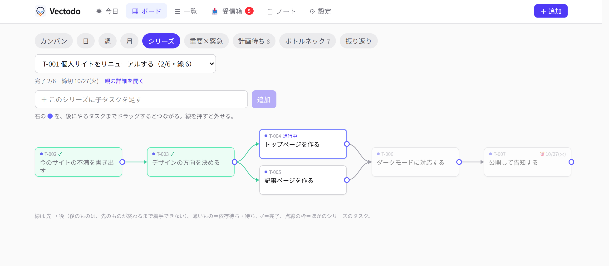
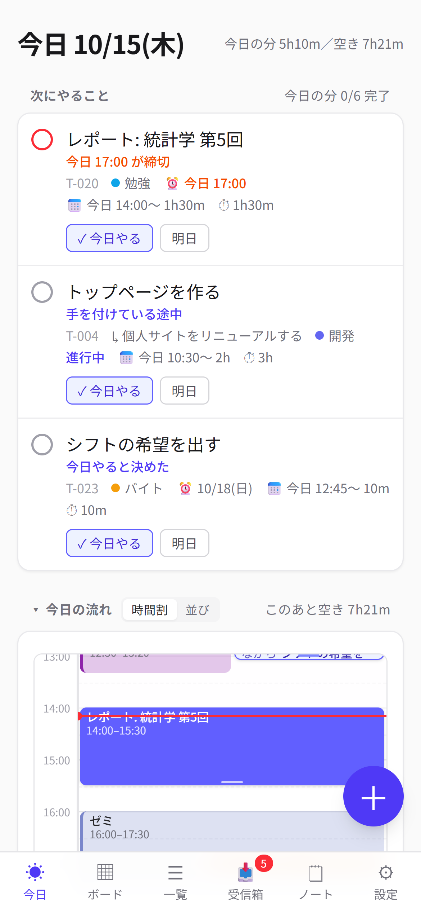
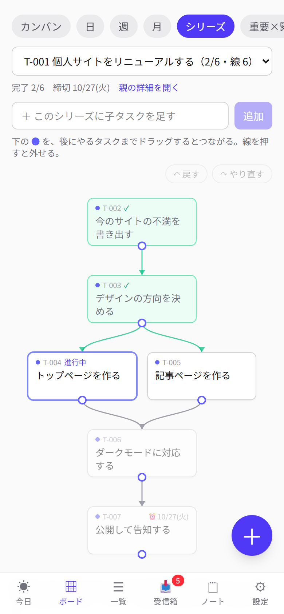
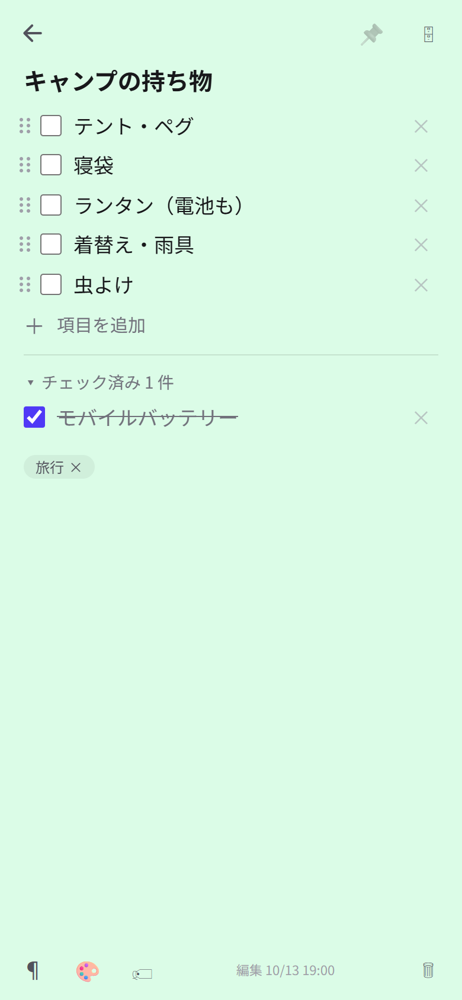
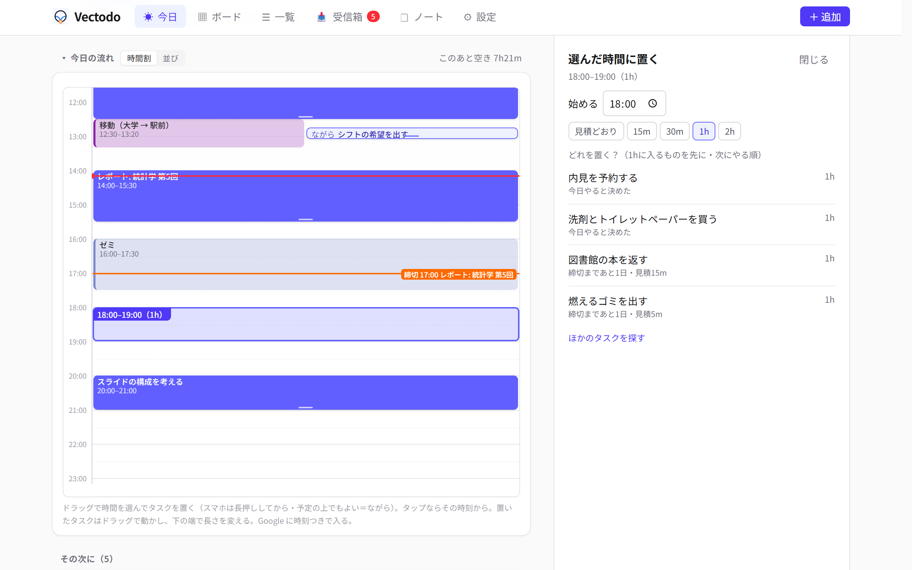

# Vectodo

タスク同士の**依存関係**（これが終わらないとあれに手を付けられない）を登録できる，自分用のタスク管理アプリです．スマホ（ホーム画面に追加して使う PWA）と PC のブラウザから使えて，Claude Code などの AI からも **MCP** で読み書きできます．

A self-hosted task manager with task dependencies, a phone-friendly PWA, one-way Google Calendar export, and a built-in MCP server for AI assistants. The UI is in Japanese.



<p>
  
  
  
</p>



※ 画面はすべて架空のデモデータです．

## できること

- **依存関係**: 「先にやる → 後にやる」の線．先が終わっていないタスクは薄く表示．親の下の子タスクの依存を図で見て，図の上でつなぐ・外す．いま手を付けられるもののうち，ほかを待たせている数が多い順（ボトルネック）
- **今日**: 次にやること3件（締切・進行中・やる日・見積から選んで理由を添える）．Google カレンダーの予定と締切を1本の時間軸に並べ，空きをドラッグで選んでタスクを置く（予定に重ねて「ながら」でも置ける）
- **ボード**: カンバン（状態／緊急度／優先度／カテゴリ）・日・週・月・シリーズ・重要×緊急・計画待ち・ボトルネック・振り返り（見積と実績の比）
- **すぐ入れる**: タイトルだけでタスクを作れる．思いつきはクイックメモへ（どちらも受信箱に入る）
- **タスクの中身**: 子タスク・複数のやる日（日ごとに時刻と配分）・締切・見積と実績・繰り返し（毎週／毎月／N日ごと／完了から N日後）・テンプレート
- **ノート**: Google Keep のような自由なメモ（チェックリスト・固定・色・ラベル・検索・アーカイブ）
- **Google カレンダーへ書き出す**（アプリ → カレンダーの一方向．前日 20:00 と締切の2時間前に通知）
- **電波がなくても読める**: 一度開いた画面は端末に残す．つながらない間のメモ・タスクの追加・ノートのチェックは溜めて，つながったら送る
- **MCP**: タスク・メモ・ノート・テンプレートを読む・作る・直すツールが21個（削除のツールは無い＝消すのは画面からだけ）

## 試してみる（架空のデータ）

Node.js 22.13 以上（組み込みの `node:sqlite` を使う）が要ります．

```sh
npm install
npm run build       # 画面をビルド
npm run demo:seed   # data/demo.db に架空のデータを作る（今日を基準に並ぶ）
npm run demo        # http://localhost:5190 で開く
```

デモは Google カレンダーにつながないので，予定の重ね表示は出ません．

## 自分で使う

1. `cp config.example.json config.json` して中身を直す（`dbPath`・`backupDir`・`timezone` など）
2. `npm run build && npm start` → `http://localhost:5180`
3. Claude Code に MCP を登録する: `claude mcp add --transport http --scope user task-app http://localhost:5180/mcp`
4. スマホから開くなら [Tailscale](https://tailscale.com/) の Serve で tailnet の中にだけ出す: `tailscale serve --bg --https=5180 http://127.0.0.1:5180` → `config.json` の `allowedHosts` に `<マシン名>.<tailnet>.ts.net` を足す
5. 常駐させるなら `deploy/task-app.service` のユーザー名とパスを直して `/etc/systemd/system/` へ置き，`sudo systemctl enable --now task-app`

### ⚠ セキュリティ

**ログイン機能はありません**．サーバは `127.0.0.1` だけで待ち受けるので，外から開くときは Tailscale のような「自分の端末だけが入れる経路」を使ってください．⛔ インターネットにそのまま公開しないでください．

- `Host` ヘッダが `allowedHosts` に無いリクエストは 403（DNS リバインディング対策）
- 書き込みは `Content-Type: application/json` だけ受け付ける（ほかのサイトからのフォーム送信を防ぐ）

## Google カレンダー（任意）

締切とやる日を Google カレンダーへ一方向に書き出します．最初の1回だけ，Google 側の準備と認可が要ります．

1. [Google Cloud Console](https://console.cloud.google.com/) でプロジェクトを作る
2. 「API とサービス」→「ライブラリ」で **Google Calendar API** を有効にする
3. 「Google Auth Platform」（旧「OAuth 同意画面」）を始める: アプリ名・サポートメールと連絡先は自分・対象は**外部**
4. 「対象」で**公開ステータスを「本番環境」にする**（「テスト」のままだと7日でつながりが切れる．自分しか使わないので審査は要らず，「未確認のアプリ」の注意が出るだけ）
5. 「クライアント」→ 種類 **デスクトップ アプリ** で作成 → **JSON をダウンロード**
6. その JSON を `~/.config/task-app/google-client.json` に置いて `chmod 600`（⛔ リポジトリに置かない）
7. PC のブラウザで `http://localhost:5180/settings` →「Google カレンダー」→「Google につなぐ」→ 自分のアカウントで許可

- 書き込み先のカレンダーは，設定画面でカテゴリごとに選べる
- トークンは `~/.config/task-app/google-token.json`（アプリが書く・0600）．切るときは設定の「切る」
- 予定の説明欄にタスクを開くリンクを載せたいときは，`config.json` の `gcal.appUrl` にスマホから開ける URL を入れる

## 開発

| やること | コマンド |
|---|---|
| 手元で起動（変更で再起動） | `npm run dev` |
| 画面の開発（ホットリロード） | `npm run dev:web` → `http://localhost:5181`（API は 5180 へ中継） |
| 画面のビルド | `npm run build`（サーバを再起動しなくても，再読み込みで新しい画面になる） |
| テスト | `npm test` |
| 型チェック | `npm run typecheck` |
| アイコンの作り直し | `npx tsx scripts/make-icons.ts` |

- 構成: Node.js + TypeScript，[Hono](https://hono.dev/)，SQLite（`node:sqlite`），zod，MCP の TypeScript SDK（Streamable HTTP），React 19，TanStack Query，Tailwind CSS v4，dnd-kit，Vite，Vitest
- 1つのサーバが，画面（`dist/web`）・画面用の API（`/api`）・AI 用の MCP（`/mcp`）を出す
- 要件は [`docs/requirements.md`](docs/requirements.md)，設計（データモデル・API・MCP・画面・運用）は [`docs/design.md`](docs/design.md)，別のマシンへ移す手順は [`docs/migration.md`](docs/migration.md)
- 画面に出る名前は Vectodo ですが，パッケージ・systemd のユニット・MCP のサーバ名は `task-app` です

## データ

- DB: `config.json` の `dbPath`（既定 `data/tasks.db`・git 管理外）
- バックアップ: `backupDir` を入れると1日1回 `tasks-YYYY-MM-DD.db` を書き出す（`backupKeepDays` 日分）
- 戻すとき: サーバを止めて，バックアップの `.db` を `dbPath` に上書きコピーし，`-wal`・`-shm` を消してから起動する

## ライセンス

[MIT](LICENSE)
